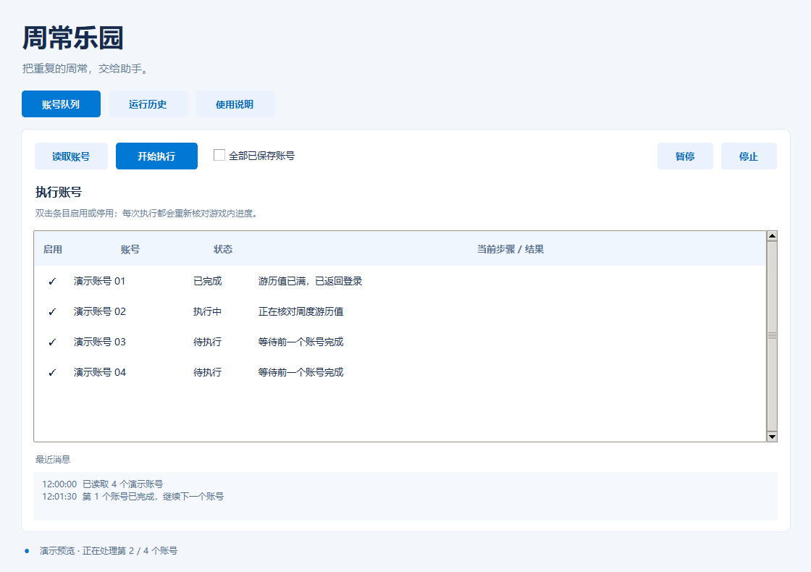

# 周常乐园

一个面向 **《鸣潮》国服官服** 的 Windows 桌面周常助手。读取游戏保存的账号，逐号执行幻梦游园、复核周度游历值、点击领取奖励并返回登录。

Windows 蓝主题 · 多账号队列 · 后台窗口操作 · 本地运行记录



> 项目仍处于实机适配阶段。单账号流程及部分多账号流程已跑通，但后台登录点击仍可能偶发失败；失败会记录并停止该账号，不保证无人值守完成所有账号。截图中的账号为演示数据。

## 功能

- 从游戏原生登录控件读取已保存账号，无需在助手中填写密码。
- 按启用的账号顺序执行，也可选择全部已保存账号。
- 读取角色标识并绑定账号，发现身份不一致时停止。
- 按游戏内实际周度游历值判断进度；不足 6000 继续乐园，达到目标后执行两次奖励领取点击。
- 完成后返回登录页面，继续下一个账号。
- 支持暂停、继续、停止；提供最近 200 条运行记录及本机失败诊断。

完成记录表示已核对进度并执行领取点击，**不代表逐项验证所有奖励均已到账**。

## 运行环境

- Windows 10 / 11，64 位 Python，包含 Tkinter。
- 开发机使用 Python 3.14；其他版本尚未完整验证。
- 鸣潮国服官服客户端，账号已在游戏登录界面保存。
- 目前主要按 2560 × 1440 游戏客户区实测。其他分辨率、缩放或界面版本可能需要适配。
- 游戏窗口必须保持非最小化。后台运行使用 Windows 窗口消息与截图，不移动系统鼠标；不代表所有页面都能稳定接受后台输入。

## 安装

1. 安装 64 位 Python，并选择加入 PATH。
2. 下载源码并解压到可写目录，或使用 GitHub Desktop 克隆项目。
3. 双击 `setup.cmd`，创建 `.venv` 虚拟环境并安装依赖。首次安装需要联网。
4. 双击 `start.cmd` 启动。游戏以管理员身份运行时，使用 `start-admin.cmd`，并接受 Windows 的权限提示。

也可以在项目目录执行：

```powershell
python -m venv .venv
.\.venv\Scripts\python.exe -m pip install -r requirements.txt
.\.venv\Scripts\python.exe main.py
```

旧开发环境的 `.deps` 目录仍兼容，但不是发布内容。新安装建议使用 `.venv`。

## 使用

1. 打开游戏，停留在带有已保存账号下拉框的登录界面。
2. 打开助手，点击 **读取账号**。
3. 双击队列中的条目启用或停用。勾选 **全部已保存账号** 时，以启动执行时重新读取的完整列表为准。
4. 点击 **开始执行**，在队列中查看当前步骤。
5. 批次结束后查看 **运行历史**。失败后先手动回到账号登录界面，再选择需要重试的账号。

暂停在流程检查点生效；停止不会关闭游戏，也不会自动把当前页面恢复成登录界面。关闭助手时会先请求停止正在运行的任务。

## 常见问题

**找不到游戏窗口 / 找到多个窗口**  
保持唯一的鸣潮游戏窗口，恢复最小化窗口，再读取账号。

**Windows 错误 5 / 后台输入被拒绝**  
关闭助手，使用 `start-admin.cmd` 重新启动，使助手具备与游戏匹配的权限。

**登录按钮没有反应**  
这是当前已知的偶发问题。程序最多尝试三次点击，并核对页面变化；仍停留在登录框时记录失败，不直接认定登录成功。可以在游戏中手动确认该账号是否能正常登录，再回到登录界面重试。

**识别失败、画面没有变化或卡在某个页面**  
查看运行历史，并通过“使用说明 → 打开数据目录”找到 `data/evidence/`。反馈时附上发生步骤和经过脱敏的相关日志、截图。

**是否支持国际服、B 服、最小化运行？**  
目前不支持。也没有实现验证码处理、账号注册或自动填写密码。

## 本地数据

| 路径 | 用途 |
| --- | --- |
| `data/accounts.json` | 上次读取的脱敏账号列表 |
| `data/history.db` | 运行记录及账号与角色标识的绑定 |
| `data/profile.json` | 首次启动从默认配置复制的本机配置 |
| `data/evidence/` | 失败截图、页面识别和动作记录 |

这些数据仅供本机使用，已在 `.gitignore` 中排除。截图、UID、脱敏手机号仍可能含有个人信息，提交 Issue 前请检查并遮挡。升级源码时保留 `data/` 即可保留记录；不要用它作为公开测试数据。

## 项目结构

```text
main.py                 程序入口
setup.cmd               安装到虚拟环境
start.cmd               普通启动
start-admin.cmd         管理员启动
requirements.txt        Python 依赖
profiles/cn.json         默认官服配置
garden/                界面、识别、输入及执行流程
tests/                 自动测试和脱敏页面文字样本
tools/                 开发者只读截图验证工具
docs/                  界面示例、开发和发布说明
```

## 开发与测试

在 Windows 环境安装依赖后运行：

```powershell
.\.venv\Scripts\python.exe -m unittest discover -s tests
```

目前包含 84 项自动测试，覆盖账号读取、身份核验、登录转移、周常页面、队列与失败处理。测试通过不等同于实机全流程通过。

开发者截图检查工具与贡献说明见 [开发说明](docs/DEVELOPMENT.md)。使用 GitHub Desktop 首次上传的流程见 [发布说明](docs/PUBLISHING.md)。

## 参考与许可

流程设计参考了 [OK-Wuthering-Waves](https://github.com/ok-oldking/ok-wuthering-waves) 的周常乐园及多账号处理方式，具体范围见 [参考说明](docs/REFERENCE.md)。本项目采用独立实现，不依赖对方项目运行。

本项目原创代码采用 [MIT License](LICENSE)。游戏名称、游戏画面及用于页面识别的游戏界面小图属于相应权利人，不因代码的 MIT 许可证而转授其权利。本项目是非官方工具，与游戏运营方无隶属关系。
